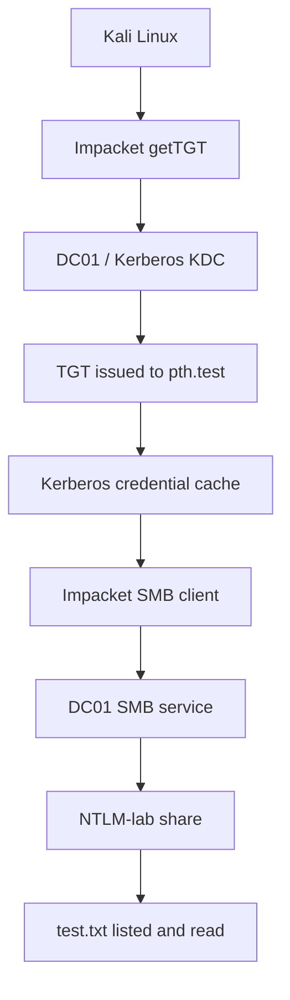

# Pass-the-Ticket (PtT) — Active Directory Security Lab

## 1. Objective

The objective of this lab was to understand Kerberos Ticket-Granting Tickets (TGTs), inspect a Kerberos credential cache, and test whether cached Kerberos credentials could be used to access an authorized SMB share in a controlled Active Directory environment.

This exercise focuses on understanding Kerberos authentication and documenting observable evidence.

## 2. Lab Environment

| Component         | Details                      |
| ----------------- | ---------------------------- |
| Domain            | `harish.local`               |
| NetBIOS domain    | `HARISH`                     |
| Domain Controller | `DC01`                       |
| DC01 IP           | `192.168.182.10`             |
| Kali Linux IP     | `192.168.182.129`            |
| Test account      | `pth.test`                   |
| SMB target        | `NTLM-lab` share             |
| Tools             | Impacket, Kerberos utilities |

All tests were performed against the author's isolated lab environment.

## 3. What Is Pass-the-Ticket?

Pass-the-Ticket (PtT) is an authentication technique in which an attacker uses an obtained Kerberos ticket to authenticate to a service without necessarily knowing the account's plaintext password.

Kerberos tickets are issued as part of the Kerberos authentication process. Depending on the ticket type, they can allow a user to request access to services in a domain.

Two important ticket types are:

- **Ticket-Granting Ticket (TGT):** Used to request service tickets from the Key Distribution Center (KDC).
- **Service Ticket (TGS):** Used to authenticate to a particular service, such as SMB.

A ticket's usefulness depends on its validity, the account's permissions, the target service, and the domain's security configuration.

## 4. Lab Architecture



## 5. Practical Implementation

### Step 1: Check Tool Availability

The following command was used to verify that the ticket conversion utility was installed:

```bash
impacket-ticketConverter -h
```

**Observed result:** The tool displayed its usage information.

The TGT-requesting utility was also checked:

```bash
which impacket-getTGT
```

**Observed result:**

```text
/usr/bin/impacket-getTGT
```

### Step 2: Check the Initial Kerberos Cache

Command:

```bash
klist
```

**Observed result:**

```text
klist: No credentials cache found (filename: /tmp/krb5cc_0)
```

This indicated that no credentials cache was available at the default location for that command invocation.

### Step 3: Check Time Configuration

Kerberos authentication relies on time-sensitive tickets, so the system times were compared.

Kali time was checked with:

```bash
date
```

DC01 time was checked with:

```powershell
Get-Date
```

The domain controller's time zone was checked with:

```powershell
Get-TimeZone
```

Its UTC time was checked with:

```powershell
(Get-Date).ToUniversalTime()
```

**Observation:** The systems used different time zones. Comparing UTC values is the appropriate way to assess clock differences.

### Step 4: Request a TGT

A TGT was requested for the dedicated test account:

```bash
impacket-getTGT harish.local/pth.test -dc-ip 192.168.182.10
```

The account password was entered when prompted and was not included in the command itself.

**Observed result:** A file named `pth.test.ccache` was created.

This showed that the TGT request completed successfully and a Kerberos credential cache was saved.

### Step 5: Set the Credential Cache

Command:

```bash
export KRB5CCNAME="$PWD/pth.test.ccache"
```

The environment variable was checked with:

```bash
echo "$KRB5CCNAME"
```

**Observed result:** The path pointed to the `pth.test.ccache` file in the current directory.

### Step 6: Verify the TGT

Command:

```bash
klist
```

**Observed evidence:**

```text
Ticket cache: FILE:/home/kali/pth.test.ccache
Default principal: pth.test@HARISH.LOCAL

Valid starting       Expires              Service principal
10/17/2026 07:14:13  10/17/2026 17:14:13  krbtgt/HARISH.LOCAL@HARISH.LOCAL
        renew until 10/18/2026 07:16:40
```

The output confirmed that the cache contained a TGT for `pth.test@HARISH.LOCAL`.

The ticket had a start time, expiry time, and renewal limit. These values are evidence of the ticket's recorded validity period, not proof that every service will accept it.

### Step 7: Connect to SMB Using the Cached Ticket

The following command was used to open the Impacket SMB client with Kerberos authentication:

```bash
KRB5CCNAME="$PWD/pth.test.ccache" impacket-smbclient -k -no-pass harish.local/pth.test@DC01.harish.local
```

The SMB client opened an interactive prompt.

The `shares` command was used to inspect available shares. The `NTLM-lab` share was selected:

```text
use NTLM-lab
```

The directory listing was requested with:

```text
ls
```

**Observed result:**

```text
.
..
test.txt
```

The listing showed that the selected share was accessible to the authenticated session.

### Step 8: Read the Test File

Command:

```text
cat test.txt
```

**Observed result:**

```text
NTLM Lab Test
```

This confirmed that the session could read the test file in the share.

## 6. Results Summary

| Test                   | Result     | Evidence                               |
| ---------------------- | ---------- | -------------------------------------- |
| Impacket utility check | Successful | Help output displayed                  |
| TGT request            | Successful | `pth.test.ccache` created              |
| TGT verification       | Successful | `klist` displayed the TGT              |
| SMB connection         | Successful | Interactive SMB client opened          |
| Share access           | Successful | `NTLM-lab` directory listing displayed |
| Test file read         | Successful | `test.txt` returned expected text      |

## 7. Important Scope and Limitations

This lab demonstrated the following:

- A TGT was requested for a dedicated test account.
- The resulting ticket cache was inspected.
- Cached Kerberos credentials were used in an SMB client session.
- The authenticated session accessed a test share and read a test file.

**This was not a complete demonstration of stealing and replaying another user's ticket.** The TGT was obtained directly for the test account using its known lab password. The test therefore demonstrates Kerberos ticket use and authorized resource access, rather than credential theft from a victim system.

The results also do not prove administrator privileges or access to unrelated shares. Only the resources actually tested are documented here.

## 8. Security Risks

If an attacker obtains a usable Kerberos ticket, they may be able to authenticate as the ticket's principal within the ticket's validity and authorization constraints.

Potential consequences include:

- Unauthorized access to network shares and services.
- Access under the permissions of the affected account.
- Lateral movement if the account has access to other systems.
- Increased impact if tickets or credentials for privileged accounts are compromised.

A TGT is not equivalent to an unrestricted administrator credential. Access remains dependent on the environment and the account's rights.

## 9. Detection and Monitoring

Defenders can investigate suspicious Kerberos and SMB activity using domain-controller and endpoint telemetry.

Useful Windows Security events include:

- **4768:** A Kerberos authentication ticket (TGT) was requested.
- **4769:** A Kerberos service ticket was requested.
- **4624:** A logon was successful.
- **5140:** A network share was accessed.
- **5145:** A network share object was checked for access.

Event availability depends on audit policy, operating-system configuration, and the activity performed. No claim is made that every listed event was collected during this lab.

Investigation should correlate account names, source systems, timestamps, destination services, and expected user activity. A single event does not automatically establish malicious behavior.

## 10. Mitigation and Best Practices

1. Protect endpoints where Kerberos tickets are cached.
2. Apply least-privilege access to accounts and SMB shares.
3. Avoid using highly privileged accounts for routine tasks.
4. Use strong authentication protections and secure administrative workstations.
5. Monitor unusual Kerberos ticket requests and SMB access.
6. Restrict access to sensitive systems and shares.
7. Protect domain-controller and endpoint credentials from unauthorized access.
8. Investigate suspected ticket compromise and revoke or invalidate access through appropriate incident-response procedures.

## 11. Interview Questions and Answers

### Q1. What is Pass-the-Ticket?

Pass-the-Ticket is a technique in which an obtained Kerberos ticket is used to authenticate to a service without necessarily supplying the account's plaintext password.

### Q2. What is a TGT?

A Ticket-Granting Ticket is a Kerberos ticket that allows a client to request service tickets from the domain's Key Distribution Center.

### Q3. What is the difference between a TGT and a TGS?

A TGT is used to request service tickets. A TGS, or service ticket, is used to authenticate to a specific service.

### Q4. What is a `.ccache` file?

A `.ccache` file is a Kerberos credential-cache format commonly used by Unix-like systems and tools to store Kerberos credentials and tickets.

### Q5. Does possessing a TGT automatically provide administrator access?

No. A TGT represents a Kerberos principal and is used to request service tickets. The resources accessible to that principal depend on its permissions and the service's authorization rules.

### Q6. What did this lab prove?

It proved that a TGT was issued for the dedicated test account, that the ticket was present in a credential cache, and that the cached credentials were used for successful SMB access to the `NTLM-lab` share.

### Q7. Did this lab demonstrate ticket theft?

No. The TGT was requested using the known password of the dedicated test account. Ticket theft and replay from a separate victim session were not demonstrated.

## 12. Conclusion

This lab provided practical experience with Kerberos TGT acquisition, credential-cache inspection, and Kerberos-based SMB access.

The results reinforced the importance of protecting Kerberos credentials, enforcing least privilege, and monitoring authentication and network-share activity. The experiment was limited to the dedicated lab account and the resources explicitly tested.

## 13. Evidence Checklist

- [x] Impacket ticket utility availability verified.
- [x] Initial cache state recorded.
- [x] TGT request completed.
- [x] TGT metadata verified using `klist`.
- [x] SMB session opened using cached Kerberos credentials.
- [x] `NTLM-lab` share listed.
- [x] `test.txt` read successfully.
- [x] Limitations documented honestly.
- [x] Add screenshots of the terminal outputs to the repository.


