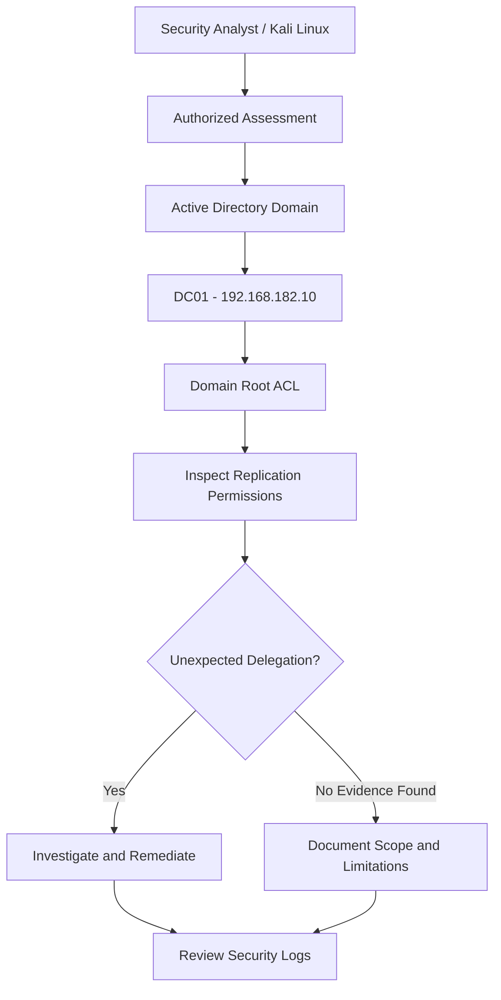

# DCSync Attack — Active Directory Security Lab

## 1. Objective

The objective of this lab is to understand the DCSync attack technique, inspect Active Directory replication permissions, identify potentially dangerous delegation, and document the security implications and detection methods.

**Lab status:** Replication-permission inspection completed. Successful DCSync execution and credential extraction were not demonstrated.

## 2. Lab Environment

| Component | Details |
|---|---|
| Domain | `harish.local` |
| NetBIOS domain | `HARISH` |
| Domain Controller | `DC01` |
| DC01 IP | `192.168.182.10` |
| Kali Linux IP | `192.168.182.129` |
| Test account | `acl.operator` |
| Tools | Windows PowerShell, Active Directory PowerShell module |

All observations relate to the authorized, isolated lab environment.

## 3. What Is DCSync?

DCSync is an Active Directory credential-access technique that abuses directory replication permissions. A principal with the required replication rights can request directory data in a manner resembling a domain controller replicating directory information.

Depending on the permissions and data requested, this can expose password-derived secrets, including password hashes.

DCSync does not necessarily require interactive access to the domain controller. Its feasibility depends on the account's effective permissions and the domain's configuration.

### Important replication permissions

- **DS-Replication-Get-Changes:** Allows replication-related directory changes to be requested.
- **DS-Replication-Get-Changes-All:** Allows replication of additional secret domain data.
- **DS-Replication-Get-Changes-In-Filtered-Set:** Relates to replication of attributes in the filtered attribute set.

The exact combination required depends on the operation and directory configuration.

## 4. Lab Architecture



## 5. Practical Implementation

### Step 1: Open PowerShell on DC01

Sign in to `DC01` using an authorized administrative account and open PowerShell.

Import the Active Directory module:

```powershell
Import-Module ActiveDirectory
```

Verify the domain:

```powershell
Get-ADDomain
```

Confirm that the domain is `harish.local`.

### Step 2: Identify the domain root

Run:

```powershell
$domain = Get-ADDomain
$domain.DistinguishedName
```

Expected domain distinguished name:

```text
DC=harish,DC=local
```

This identifies the directory object whose access-control list will be inspected.

### Step 3: Inspect replication-related permissions

Run the following read-only PowerShell commands:

```powershell
$acl = Get-Acl "AD:\$($domain.DistinguishedName)"

$replicationGuids = @{
    "DS-Replication-Get-Changes" =
        "1131f6aa-9c07-11d1-f79f-00c04fc2dcd2"

    "DS-Replication-Get-Changes-All" =
        "1131f6ad-9c07-11d1-f79f-00c04fc2dcd2"

    "DS-Replication-Get-Changes-In-Filtered-Set" =
        "89e95b76-444d-4c62-991a-0facbeda640c"
}

$acl.Access |
    Where-Object {
        $_.ObjectType -in $replicationGuids.Values
    } |
    Select-Object IdentityReference,
                  ActiveDirectoryRights,
                  AccessControlType,
                  ObjectType,
                  IsInherited |
    Format-Table -AutoSize
```

**Observed result:**

The inspection returned replication-related access-control entries for several security principals, including:

- `NT AUTHORITY\ENTERPRISE DOMAIN CONTROLLERS`
- `BUILTIN\Administrators`
- `HARISH\Enterprise Read-only Domain Controllers`
- `HARISH\Domain Controllers`

The displayed entries included replication-related extended rights.

No entry for `acl.operator` appeared in this particular filtered output.

**Interpretation:** This output is a useful initial ACL inspection, but it does not prove the account lacks every possible effective replication permission. The query only selects entries whose `ObjectType` matches the three specified GUIDs. Nested group membership, inherited permissions, deny entries, and other delegation paths require separate consideration.

### Step 4: Inspect direct group membership

Run:

```powershell
Get-ADPrincipalGroupMembership -Identity "acl.operator" |
    Select-Object Name, GroupScope, SID |
    Format-Table -AutoSize
```

**Observed result:**

```text
Name         GroupScope  SID
----         ----------  ---
Domain Users Global      S-1-5-21-497824287-1873158813-3411289278-513
```

This output showed `Domain Users` as a direct group membership in the returned results.

**Important limitation:** This command alone does not establish all effective permissions. Nested group membership and access-control entries must also be considered.

### Step 5: Record the current assessment result

Based on the evidence collected:

- The domain root's replication-related access-control entries were inspected.
- Standard domain-controller and administrator-related principals appeared in the results.
- `acl.operator` did not appear in the filtered replication-rights output.
- Direct group membership was inspected.
- No successful DCSync operation was demonstrated.
- No password hashes or other domain credentials were extracted during the documented exercise.

The accurate conclusion is that the available evidence did not demonstrate DCSync capability for `acl.operator`. It is not a complete proof that no exploitable permission path exists.

## 6. Detection and Monitoring

DCSync investigations can use Windows Security auditing and identity-security monitoring.

### Relevant Windows Security event

**Event ID 4662 — An operation was performed on an object**

This event can record operations on Active Directory objects when the appropriate auditing policy and object-level SACLs are configured.

For replication-related investigations, defenders should correlate:

- The account that performed the operation.
- The domain object involved.
- The access rights and object-type GUIDs.
- The originating system and surrounding authentication activity.
- Whether the activity matches expected domain-controller replication.

Event 4662 is not guaranteed to appear for every attempted or successful DCSync operation. Audit policy, SACL configuration, and available telemetry affect what is recorded.

### Review recent event 4662 records

On DC01, in an elevated PowerShell session, run:

```powershell
Get-WinEvent -FilterHashtable @{
    LogName = 'Security'
    Id      = 4662
} -MaxEvents 100 -ErrorAction SilentlyContinue |
    Select-Object TimeCreated, Id, ProviderName, Message |
    Format-List
```

This command displays recent matching events that are available in the Security log. It does not automatically identify DCSync activity; the event messages must be reviewed and correlated with the relevant object access and replication rights.

If no matching events appear, do not conclude that DCSync is impossible. The events may not have been generated, audited, or retained.

## 7. Security Risks

If an unauthorized principal obtains sufficient replication permissions, potential consequences include:

1. Exposure of password-derived secrets from Active Directory.
2. Compromise of privileged accounts if their secrets are exposed.
3. Further compromise of domain resources using stolen credentials.
4. Persistence or lateral movement following a domain compromise.
5. Increased recovery effort because credentials and trust relationships may need to be reviewed.

The impact depends on which secrets are exposed, which accounts are affected, and the surrounding security configuration.

## 8. Mitigation and Best Practices

1. Apply least privilege to Active Directory delegation.
2. Restrict replication permissions to the principals that genuinely require them.
3. Review domain-root ACLs and inherited access-control entries periodically.
4. Audit nested group memberships and unexpected privileged delegation.
5. Protect domain controllers and privileged administrative accounts.
6. Enable appropriate directory-service auditing and retain relevant logs.
7. Investigate unusual replication activity from workstations or non-domain-controller systems.
8. Review and remove unnecessary replication rights through a controlled change process.
9. After suspected credential exposure, follow incident-response procedures to assess the scope and rotate affected credentials as appropriate.

Do not remove standard domain-controller replication permissions without understanding their purpose; doing so can disrupt domain operation.

## 9. Interview Questions and Answers

### Q1. What is DCSync?

DCSync is a technique that abuses Active Directory replication permissions to request directory data, potentially including password-derived secrets.

### Q2. Does DCSync require local administrator access on a domain controller?

Not necessarily. The key requirement is sufficient effective directory replication permissions. The technique can request replication data remotely.

### Q3. What is DS-Replication-Get-Changes?

It is an extended right associated with requesting replication changes from Active Directory.

### Q4. What is DS-Replication-Get-Changes-All?

It is an extended right associated with replicating additional secret domain data. Its significance depends on the permissions and operation involved.

### Q5. Does membership in Domain Users automatically grant DCSync capability?

No. Ordinary Domain Users membership does not, by itself, establish that a principal has the required replication permissions.

### Q6. Which Windows event can help investigate directory object access?

Event ID 4662 can record directory-object operations when suitable auditing is configured. Investigators must examine its details and correlate it with other telemetry.

### Q7. Did this lab successfully perform DCSync?

No. The documented practical work inspected replication-related ACL entries and direct group membership. It did not demonstrate successful DCSync execution or credential extraction.

### Q8. Why is inspecting one ACL query insufficient to prove that an account cannot DCSync?

Because effective access can involve nested groups, inherited entries, deny permissions, and other delegation paths. A filtered query is only one part of an effective-permission assessment.

## 10. Results Summary

| Test | Result | Evidence |
|---|---|---|
| Active Directory module import | Completed | PowerShell command executed |
| Domain identification | Completed | Domain distinguished name obtained |
| Replication-rights inspection | Completed | Matching ACL entries displayed |
| Direct group membership inspection | Completed | `Domain Users` shown |
| Successful DCSync operation | Not demonstrated | No successful operation evidence collected |
| Credential extraction | Not performed | No credential output documented |
| Detection-log review | Investigation command provided | Results must be based on actual available logs |

## 11. Conclusion

This lab introduced DCSync and demonstrated how to inspect replication-related permissions on the Active Directory domain root. The collected output showed relevant access-control entries and the direct group membership returned for `acl.operator`.

The exercise did not demonstrate successful DCSync execution or credential extraction. The findings should therefore be presented as an initial replication-permission assessment, not as proof of a successful attack or a comprehensive proof that the account is unable to perform DCSync.

The main defensive lesson is to restrict replication permissions, regularly review effective delegation, and monitor unusual directory replication activity.


