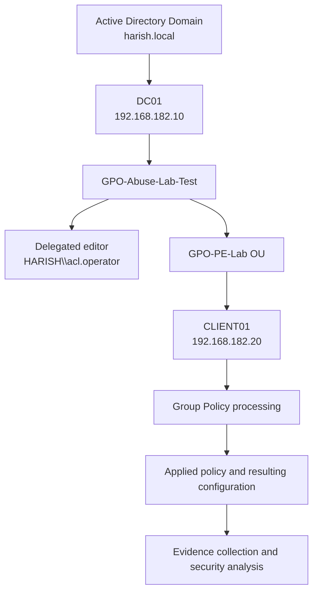

# Group Policy Object (GPO) Abuse — Active Directory Security Lab

## 1. Project Overview

### Objective

The objective of this lab is to understand how misconfigured Group Policy Object (GPO) permissions can create security risks in an Active Directory environment.

The lab examines:

- How GPOs are created and linked to Organizational Units (OUs).
- How GPO delegation controls who can read or modify Group Policy settings.
- How GPO scope, permissions, and security filtering affect policy application.
- How a writable GPO can become a privilege-escalation risk when it affects a suitable target.
- How to validate policy application and collect evidence.
- How administrators can detect and mitigate dangerous GPO delegation.

**Current result:** The dedicated test GPO was created, delegated to `acl.operator`, and linked to a test OU. However, the latest Group Policy Result output did not show the test GPO as applied. A successful privilege escalation has **not** been demonstrated.

## 2. Lab Environment

| Component | Details |
|---|---|
| Domain | `harish.local` |
| NetBIOS domain | `HARISH` |
| Domain controller | `DC01` |
| Domain controller IP | `192.168.182.10` |
| Windows client | `CLIENT01` |
| Windows client IP | `192.168.182.20` |
| Kali Linux IP | `192.168.182.129` |
| Test account | `acl.operator` |
| Target OU | `GPO-PE-Lab` |
| Test GPO | `GPO-Abuse-Lab-Test` |
| Test GPO GUID | `413b79fd-b727-4092-a121-4f1bb6277f21` |
| Virtualization | VMware Workstation |

All systems are part of an isolated, authorized lab environment.

## 3. Technical Background

### 3.1 What is a Group Policy Object?

A Group Policy Object is an Active Directory object that stores configuration settings for domain users and computers.

Administrators use GPOs to centrally manage settings such as:

- Password and account policies.
- Windows security settings.
- User interface restrictions.
- Scripts and scheduled tasks.
- Software deployment.
- Local group membership.
- Administrative restrictions.

A GPO has two principal storage components:

1. **Group Policy Container (GPC):** The Active Directory portion that stores GPO metadata and permissions.
2. **Group Policy Template (GPT):** The corresponding files stored in SYSVOL, including policy configuration data.

Both components must remain consistent for Group Policy to work correctly.

### 3.2 How GPO processing works

A simplified processing flow is:

1. A Windows computer or user authenticates to the domain.
2. The system discovers applicable domain and OU policies.
3. Group Policy processing evaluates links, inheritance, security filtering, and other applicable conditions.
4. The client retrieves the required policy data from Active Directory and SYSVOL.
5. The relevant client-side extensions process the settings.
6. The resulting configuration is applied according to the policy type and processing rules.

A GPO being present in the domain does not automatically mean that every computer receives it.

### 3.3 What is GPO abuse?

GPO abuse occurs when someone uses excessive or improperly delegated GPO permissions to modify policy settings in a way that compromises security.

For example, if an account can modify a GPO linked to an OU containing workstations, it may be able to change settings that execute with elevated privileges on those computers.

The risk depends on several conditions:

- The account can modify the GPO.
- The GPO affects a relevant target.
- The policy setting can produce a security impact.
- The policy is processed successfully.
- The resulting permissions or execution context permit the intended action.

**Important:** Permission to edit a GPO alone does not automatically grant local administrator or Domain Admin privileges.

## 4. GPO Permissions

| Permission | Meaning |
|---|---|
| `GpoRead` | Allows the principal to read the GPO. |
| `GpoApply` | Allows the principal to apply the GPO when the other processing conditions are satisfied. |
| `GpoEdit` | Allows modification of GPO settings. |
| `GpoEditDeleteModifySecurity` | Allows editing, deleting, and modifying the GPO's security permissions. |

The effective rights should be assessed alongside the GPO's scope and links.

A principal with `GpoEdit` may be able to modify a policy without being able to link it to additional OUs or change its permissions. These are distinct capabilities.

## 5. Lab Architecture



This diagram represents the intended test design. The latest evidence does not yet confirm that the test GPO was applied to `CLIENT01`.

## 6. Implementation and Evidence

### Step 1 — Create the dedicated test GPO

The test GPO was created with the name:

```text
GPO-Abuse-Lab-Test
```

Its GUID was recorded as:

```text
413b79fd-b727-4092-a121-4f1bb6277f21
```

The GPO was kept separate from the existing production-like lab policies, including `Default Domain Policy` and `Default Domain Controllers Policy`.

### Step 2 — Delegate editing permission

On DC01, the following PowerShell commands were used:

```powershell
Set-GPPermission `
  -Name "GPO-Abuse-Lab-Test" `
  -Domain "harish.local" `
  -TargetName "acl.operator" `
  -TargetType User `
  -PermissionLevel GpoRead

Set-GPPermission `
  -Name "GPO-Abuse-Lab-Test" `
  -Domain "harish.local" `
  -TargetName "acl.operator" `
  -TargetType User `
  -PermissionLevel GpoEdit
```

The reported permission for the test account was:

```text
Trustee     : acl.operator
TrusteeType : User
Permission  : GpoEdit
Inherited   : False
```

The GPMC Delegation tab also showed `acl.operator` with permission to edit settings.

**Interpretation:** The evidence supports the conclusion that `acl.operator` was granted direct GPO editing permission. It does not establish that the account successfully edited the GPO itself.

### Step 3 — Configure a harmless policy setting

In the Group Policy Management Editor, the following setting was enabled:

`User Configuration → Policies → Administrative Templates → Desktop → Hide and disable all items on the desktop`

The GPO report showed the setting as enabled.

The report also showed a user version of 1 in Active Directory and 1 in SYSVOL, while the computer version remained 0.

**Limitation:** This setting was configured from a Domain Admin session. Therefore, it does not prove that `acl.operator` independently performed an edit.

### Step 4 — Create the dedicated test OU

The following command created the OU:

```powershell
New-ADOrganizationalUnit `
  -Name "GPO-PE-Lab" `
  -Path "DC=harish,DC=local" `
  -ProtectedFromAccidentalDeletion $true
```

The OU was verified as:

```text
OU=GPO-PE-Lab,DC=harish,DC=local
```

The initial computer search in that OU returned no computer objects.

### Step 5 — Take a rollback snapshot

A VMware snapshot of `CLIENT01` was taken before moving its computer object.

The snapshot provides a rollback point if the test changes the client's policy behavior.

### Step 6 — Move CLIENT01 into the test OU

The following command was executed on DC01:

```powershell
Get-ADComputer CLIENT01 |
  Move-ADObject -TargetPath "OU=GPO-PE-Lab,DC=harish,DC=local"
```

The resulting computer distinguished name was:

```text
CN=CLIENT01,OU=GPO-PE-Lab,DC=harish,DC=local
```

**Interpretation:** The computer object was moved into the dedicated OU. This changes its OU-based policy scope but does not remove the computer from the domain.

Policies previously linked specifically to its former OU may no longer apply. The snapshot should be retained until the test is finished.

### Step 7 — Link the test GPO

The following command was used:

```powershell
New-GPLink `
  -Name "GPO-Abuse-Lab-Test" `
  -Target "OU=GPO-PE-Lab,DC=harish,DC=local" `
  -LinkEnabled Yes
```

The command was intended to link the dedicated GPO to the test OU.

The link's existence and enabled status should be documented using the GPO inheritance report. A successful link command alone is not proof that a policy was applied by the client.

### Step 8 — Attempt to refresh computer policy

An attempt to refresh computer policy under `acl.operator` returned:

```text
ERROR: Access Denied.
```

This is consistent with insufficient rights to force a computer-policy refresh from that account. It does not, by itself, demonstrate that GPO editing permission failed.

The refresh was then attempted in an authorized administrator session.

### Step 9 — Inspect Group Policy Results

The latest `gpresult /r /scope computer` output reported:

```text
COMPUTER SETTINGS

Last time Group Policy was applied: 10/19/2026 at 11:38:06 AM
Group Policy was applied from: DC01.harish.local
Domain Name: HARISH

Applied Group Policy Objects
-----------------------------
    Default Domain Policy
```

The test GPO was not listed under the applied computer policies.

**Interpretation:** The available output does not confirm that `GPO-Abuse-Lab-Test` was applied. The report does not conclusively identify the cause. Possible areas for investigation include the actual OU link, link enablement, security filtering, policy processing, and the distinction between user and computer settings.

The harmless desktop setting is a **user configuration** setting. The computer-scope report alone is therefore not sufficient to establish whether that user setting was applied.

## 7. Current Results Summary

| Test | Status | Evidence |
|---|---|---|
| Create dedicated GPO | Completed | GPO name and GUID recorded |
| Grant `acl.operator` GPO edit permission | Completed | `GpoEdit` reported as a direct permission |
| Configure harmless desktop setting | Completed by Domain Admin | GPO report showed setting enabled |
| Create dedicated OU | Completed | OU distinguished name verified |
| Snapshot CLIENT01 | Completed | VMware snapshot taken |
| Move CLIENT01 into test OU | Completed | Computer distinguished name verified |
| Link test GPO | Command executed | Final link state should be retained as evidence |
| Force computer policy as `acl.operator` | Failed | `Access Denied` |
| Confirm test GPO in computer policy results | Not confirmed | Only `Default Domain Policy` was listed |
| Demonstrate successful privilege escalation | **Not completed** | No evidence of elevated privileges produced |

## 8. Why the Test Has Not Yet Demonstrated Privilege Escalation

GPO abuse requires more than an editable GPO.

The intended security impact depends on the relationship between GPO permissions, policy scope, the target computer, and the resulting configuration. In this test, the available `gpresult` output does not confirm that the dedicated GPO was applied to the computer.

Additionally, the harmless desktop setting was configured by a Domain Admin, so the lab has not yet independently validated editing behavior under the delegated account.

It would be inaccurate to claim that the test account obtained local administrator privileges or Domain Admin privileges.

## 9. Detection and Monitoring

Administrators can investigate suspicious GPO modifications using several sources of telemetry.

### Windows Security events

- **5136:** Directory service object modified, when the relevant auditing is configured.
- **4662:** An operation was performed on an Active Directory object, when appropriate auditing and SACLs are configured.
- **4624:** Successful logon.
- **4688:** Process creation, if process-creation auditing is enabled.
- **4732:** A member was added to a security-enabled local group, when the relevant event is generated and audited.

Event availability and meaning depend on the operation performed, auditing configuration, and the system involved. These events are useful investigation sources, not guaranteed evidence that every GPO edit or policy application will generate a particular event.

### Recommended investigation

1. Identify the principal that modified the GPO.
2. Record the GPO name, GUID, and modification time.
3. Review changes to the GPO's delegation permissions.
4. Compare the GPC and GPT state when investigating inconsistencies.
5. Check the GPO links and security filtering for affected OUs.
6. Correlate client Group Policy operational logs with domain-controller events.
7. Review whether sensitive local groups or privileged settings were changed.
8. Compare the change against an approved administrative change record.

## 10. Mitigation and Hardening

1. Grant GPO editing permissions only to trusted administrative roles.
2. Avoid granting broad edit-and-security-management permissions unnecessarily.
3. Review direct and inherited GPO permissions periodically.
4. Separate policy authorship from approval and deployment.
5. Limit which OUs receive security-sensitive GPOs.
6. Monitor changes to privileged local group membership.
7. Back up GPOs before modifying security-sensitive settings.
8. Keep domain controllers in appropriately protected OUs with carefully controlled policy links.
9. Investigate unexpected policy changes and unauthorized delegation.
10. Test policy changes in a dedicated OU and disposable client before wider deployment.

## 11. Interview Questions and Answers

### Q1. What is GPO abuse?

GPO abuse is the misuse of excessive or misconfigured Group Policy permissions to change domain-user or computer settings in a way that creates a security risk.

### Q2. Does GPO edit permission automatically provide administrator access?

No. It allows modification of a GPO within the granted rights. A privilege impact depends on the GPO's scope, settings, processing, and the target's security context.

### Q3. What is the difference between a GPO and an OU?

A GPO stores configuration settings. An OU is an Active Directory container used to organize objects and can be a target for GPO links and administrative delegation.

### Q4. What is the difference between GPO linking and GPO delegation?

Linking determines where a GPO is associated for processing. Delegation determines what actions a principal is permitted to perform on the GPO.

### Q5. What does `GpoEdit` mean?

It indicates permission to edit GPO settings. It is different from permission to link a GPO or modify the GPO's security permissions.

### Q6. Why might a linked GPO not appear in `gpresult`?

Possible causes include a disabled or incorrect link, security filtering, policy-processing errors, scope differences, or a mismatch between the policy setting type and the results being inspected.

### Q7. What does `Access Denied` during `gpupdate` prove?

It shows that the attempted operation was denied in that context. It does not independently prove that GPO delegation is incorrect.

### Q8. Was privilege escalation successful in this lab?

No. The available evidence confirms delegated GPO edit permission and the test environment setup, but it does not confirm successful policy application or an increase in privileges.

## 12. Evidence Checklist

- [x] Dedicated test GPO created.
- [x] GPO GUID recorded.
- [x] Direct `GpoEdit` permission recorded for `acl.operator`.
- [x] Harmless test setting configured.
- [x] Dedicated OU created.
- [x] VMware snapshot taken.
- [x] `CLIENT01` moved to the test OU.
- [x] GPO link command executed.
- [x] Policy-refresh access-denied error recorded.
- [x] Computer-scope `gpresult` output recorded.
- [ ] Final GPO link state captured.
- [ ] User-scope policy application investigated.
- [ ] Delegated editing independently validated.
- [ ] Privilege escalation demonstrated and verified.

## 13. Conclusion

This lab explored GPO delegation, OU-based policy scope, GPO linking, and Group Policy Result analysis in an isolated Active Directory environment.

The test GPO was created and delegated to `acl.operator`, a dedicated OU was created, and `CLIENT01` was moved into that OU after a VMware snapshot was taken. The latest computer-scope Group Policy Result output listed only `Default Domain Policy`; it did not establish that the test GPO was applied.

The lab therefore documents a **partially completed GPO security assessment**, not a successful privilege-escalation exploit. The next phase would need to establish policy application and independently validate the delegated edit under the test account before drawing conclusions about privilege impact.

