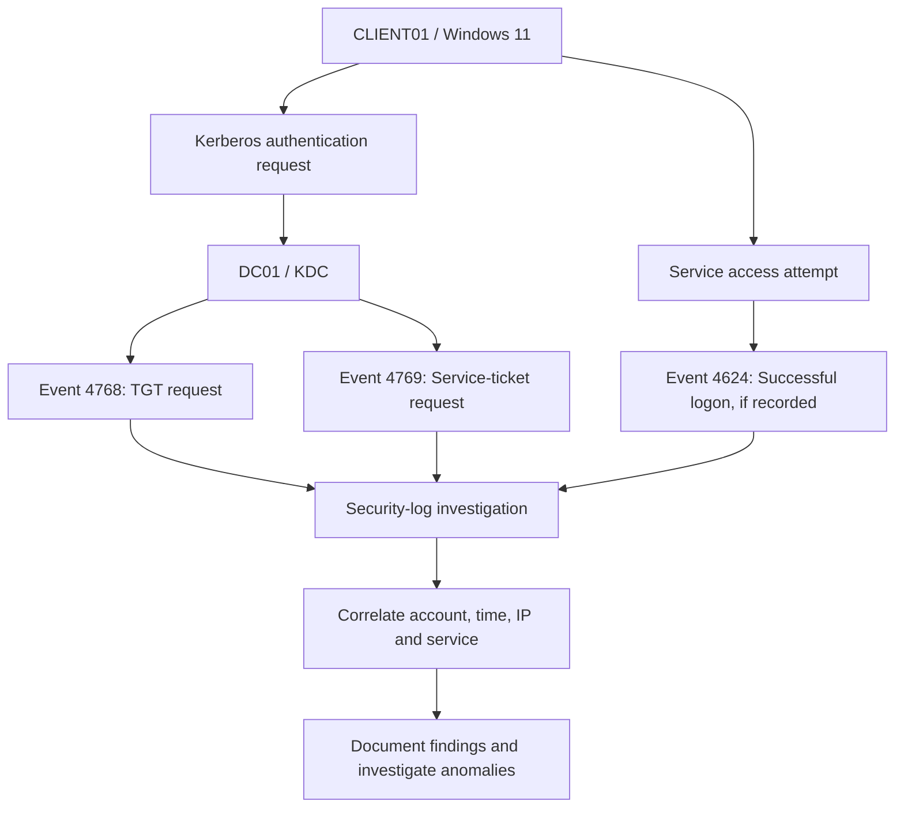

# Golden Ticket Detection Lab — Active Directory

## 1. Objective

The objective of this lab is to understand Golden Ticket attacks against Kerberos, establish a baseline of normal Kerberos activity, and examine Windows Security logs for evidence relevant to suspicious Ticket-Granting Ticket (TGT) activity.

The practical work focuses on Active Directory configuration, Kerberos event analysis, log correlation, and detection considerations in an isolated VMware lab.

**Lab status:** Detection and investigation exercises completed using collected event evidence. Golden Ticket creation and use were not demonstrated.

## 2. Lab Environment

| Component | Details |
|---|---|
| Domain | `harish.local` |
| NetBIOS domain | `HARISH` |
| Domain controller | `DC01` |
| DC01 IP | `192.168.182.10` |
| Windows client | `CLIENT01` |
| CLIENT01 IP | `192.168.182.20` |
| Kali Linux IP | `192.168.182.129` |
| Domain SID | `S-1-5-21-497824287-1873158813-3411289278` |
| Kerberos service account | `krbtgt` |
| Tools | Windows PowerShell, Active Directory PowerShell module, Windows Security logs |

All testing was performed in the author's isolated lab environment.

## 3. What Is a Golden Ticket?

A Golden Ticket is a forged Kerberos Ticket-Granting Ticket created using the secret key associated with the domain's `krbtgt` account.

In normal Kerberos authentication:

1. A client requests a TGT from the Key Distribution Center (KDC).
2. The KDC validates the request and issues a TGT.
3. The client presents the TGT to request a service ticket.
4. The client uses the service ticket to authenticate to a service.
5. The target service evaluates the authentication and authorization context.

If an attacker obtains the necessary `krbtgt` key material, they may be able to forge TGTs. The impact depends on the domain configuration, ticket contents, validity, and target service behavior.

A Golden Ticket is different from Pass-the-Ticket: Pass-the-Ticket involves using an obtained ticket, whereas a Golden Ticket involves forging a TGT.

## 4. Lab Architecture



This diagram represents the normal authentication and investigation workflow. It does not indicate that a forged ticket was created during this lab.

## 5. Domain Information Collection

The domain SID and `krbtgt` account metadata were collected on DC01 using the Active Directory PowerShell module.

```powershell
Import-Module ActiveDirectory

Get-ADDomain |
    Select-Object DNSRoot, NetBIOSName, DomainSID

Get-ADUser krbtgt -Properties Enabled, PasswordLastSet |
    Select-Object SamAccountName, Enabled, PasswordLastSet
```

### Observed results

- DNS domain: `harish.local`
- NetBIOS domain: `HARISH`
- Domain SID: `S-1-5-21-497824287-1873158813-3411289278`
- `krbtgt` account: present
- `krbtgt` account enabled state: `False`
- Recorded `PasswordLastSet`: July 24, 2026, at 5:10:35 AM

The disabled state of the special `krbtgt` account is normal in a standard Active Directory domain and does not mean Kerberos authentication is disabled.

The recorded password-change time is configuration evidence only. It does not establish whether the key is compromised or whether a Golden Ticket exists.

## 6. Windows Security Event Analysis

### 6.1 Event ID 4768 — TGT requested

Event 4768 records a Kerberos authentication ticket request.

**Collected evidence:**

| Field | Observed value |
|---|---|
| Account | `CLIENT01$` |
| Realm | `harish.local` |
| Service | `krbtgt` |
| Client address | `192.168.182.20` |
| Result code | `0x0` |
| Ticket encryption type | `0x12` |
| Pre-authentication type | `2` |

**Interpretation:** CLIENT01's computer account successfully requested a TGT. The result is consistent with normal Kerberos authentication.

A successful 4768 event alone does not establish malicious activity or distinguish every possible ticket-abuse scenario.

A second collected Event 4768 showed:

| Field | Observed value |
|---|---|
| Account | `DC01$` |
| Client address | `::1` |
| Service | `krbtgt` |
| Result code | `0x0` |
| Ticket encryption type | `0x12` |
| Pre-authentication type | `2` |

The `::1` address is IPv6 loopback, indicating that the request was recorded as originating from the local host.

### 6.2 Event ID 4769 — Service ticket requested

Event 4769 records a Kerberos service-ticket request.

**Collected evidence:**

| Field | Observed value |
|---|---|
| Account | `harish@HARISH.LOCAL` |
| Service name | `CLIENT01$` |
| Client address | `192.168.182.20` |
| Result code | `0x0` |
| Ticket encryption type | `0x12` |
| Logon GUID | `{1c4f544f-d763-6d1d-44fb-81ff4c7eb172}` |
| Timestamp | October 19, 2026, at 10:50:45 AM |

**Interpretation:** The KDC successfully processed a request for a service ticket associated with `CLIENT01$`. This does not by itself prove that the requested service was accessed successfully.

Another collected Event 4769 listed `krbtgt` as the service name. Since `krbtgt` is normally associated with TGT issuance in Event 4768, that 4769 record should be treated as an unusual observation requiring context, rather than proof of a Golden Ticket.

### 6.3 Event ID 4624 — Successful logon

Event 4624 records a successful logon session on the computer where the event was generated.

**Collected evidence:**

| Field | Observed value |
|---|---|
| Timestamp | October 19, 2026, at 12:32:00 PM |
| Logon type | `3` — Network |
| New logon account | `DC01$` |
| Security ID | `S-1-5-18` |
| Authentication package | Kerberos |
| Source address | `192.168.182.10` |
| Elevated token | Yes |
| Impersonation level | Impersonation |

**Interpretation:** DC01 recorded a successful Kerberos network logon for `DC01$` from its own IP address. This is compatible with local computer or service-related activity.

The elevated-token field does not prove that a Golden Ticket was used or that an attacker gained Domain Admin privileges.

## 7. Baseline Versus Suspicious Indicators

| Indicator | What it may suggest | Investigation required |
|---|---|---|
| Successful Event 4768 for a computer account | Normal machine authentication | Check account, source IP and expected activity |
| Successful Event 4769 for a known service | Normal service access request | Verify the target service and associated logon |
| Unexpected source address for a privileged account | Possible account misuse | Check asset ownership and authentication history |
| Ticket requests at unusual times | Potential anomaly | Compare with normal schedules and automation |
| Unexpected encryption type or authentication pattern | Possible configuration issue or anomaly | Verify domain policy, OS support and account configuration |
| Unexpected service names or unusual ticket patterns | Potentially suspicious activity or unusual configuration | Validate against Windows version, event details and expected behavior |
| Successful logon without a clearly correlated ticket event | Incomplete visibility or a different authentication path | Check audit coverage and the target system's logs |

No single indicator in this table proves a Golden Ticket. Detection should combine multiple signals and establish the expected behavior of the environment.

## 8. Detection and Investigation Workflow

A defender investigating suspected Golden Ticket activity can:

1. Identify the account, source address, destination service and timestamp.
2. Review Event 4768 for TGT requests.
3. Review Event 4769 for service-ticket requests.
4. Review Event 4624 on the destination computer for successful logons.
5. Correlate logon GUIDs where available.
6. Compare the activity with known users, computer accounts, administrative tasks and service behavior.
7. Investigate unusual account or ticket patterns with additional endpoint and domain-controller telemetry.
8. Preserve relevant logs and record findings before making changes.

Events may be missing because of audit-policy settings, retention limits, collection gaps or differences in authentication flows. The absence of an event is not proof that an attack occurred.

## 9. Recommended Defensive Measures

- Protect domain controllers and administrative endpoints.
- Restrict privileged account access and use least privilege.
- Monitor Kerberos authentication and service-ticket activity.
- Review `krbtgt` account and domain security configuration.
- Maintain reliable time synchronization across domain systems.
- Enable appropriate Windows Security auditing and central log collection.
- Investigate unexpected privileged authentication promptly.
- Follow Microsoft's documented recovery procedure if compromise of the `krbtgt` key is confirmed. Reset planning must account for replication, ticket lifetimes and the domain's operational requirements.

A suspected compromise of `krbtgt` is a domain-level incident and should be handled through a controlled incident-response process, not an improvised password reset.

## 10. Limitations

This exercise collected domain metadata and reviewed Windows Security events related to Kerberos authentication.

The collected evidence demonstrates successful TGT and service-ticket requests and a successful network logon. It does **not** demonstrate:

- Extraction of the `krbtgt` secret key.
- Creation of a forged Golden Ticket.
- Acceptance of a forged TGT by a service.
- Successful impersonation using a forged ticket.
- Privilege escalation to Domain Admin.
- A confirmed Golden Ticket detection alert.

These limitations are explicitly documented so the lab report does not overstate its results.

## 11. Interview Questions and Answers

### Q1. What is a Golden Ticket?

A Golden Ticket is a forged Kerberos TGT created using the domain's `krbtgt` secret key. If usable, it may enable authentication under forged ticket claims, subject to the environment and service behavior.

### Q2. What is the role of the `krbtgt` account?

It is the special Active Directory account whose secret key is used by the KDC in Kerberos ticket operations, including protecting TGTs.

### Q3. What is the difference between Event 4768 and Event 4769?

Event 4768 records TGT requests. Event 4769 records service-ticket requests.

### Q4. Does Event 4768 with result code `0x0` prove a Golden Ticket?

No. It indicates a successful TGT request. Additional evidence is required to investigate suspected ticket forgery.

### Q5. Does an elevated token in Event 4624 prove Golden Ticket use?

No. It describes the logon session's token status, not how the authentication ticket was obtained.

### Q6. Why correlate domain-controller and endpoint logs?

The KDC records ticket requests, while the target system records its own logon activity. Correlation can help establish which account requested access and whether a related logon occurred.

### Q7. Was a Golden Ticket attack successfully demonstrated in this lab?

No. The evidence collected is relevant to Kerberos monitoring, but forged-ticket creation and use were not demonstrated.

## 12. Conclusion

This lab established a basic Kerberos event-analysis workflow using an isolated Active Directory environment. Domain information was collected, successful TGT and service-ticket requests were inspected, and a successful Kerberos network logon was reviewed.

The exercise demonstrates how Windows Security events can support authentication investigations. It also reinforces the importance of correlating account identity, service, source address, timestamp and destination-system evidence before reaching a security conclusion.

**Final status:** Kerberos detection and log-analysis exercise documented; Golden Ticket attack execution not demonstrated.

