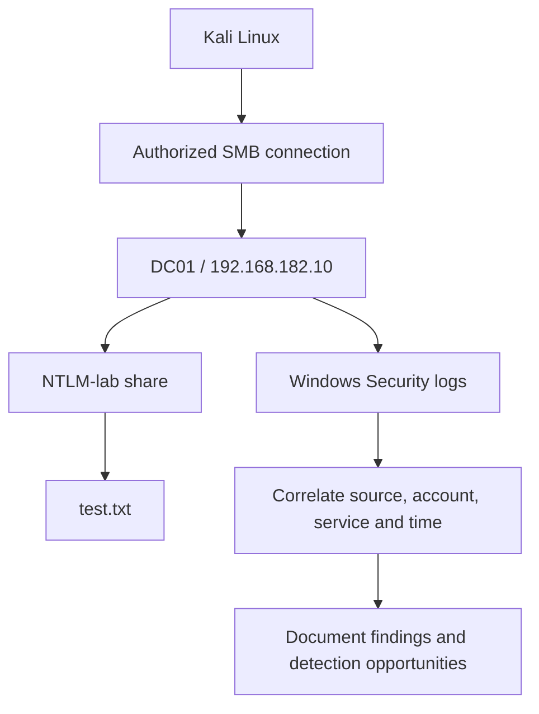

# Active Directory Lateral Movement Assessment

## 1. Objective

The objective of this lab is to understand lateral movement in an Active Directory environment, assess authorized remote resource access, and examine Windows Security events that can help detect suspicious movement between systems.

The exercise uses an isolated VMware lab and a dedicated test account. It focuses on SMB access, authentication evidence, network logons, and defensive monitoring.

**Lab status:** Assessment workflow documented. Successful unauthorized lateral movement has not been demonstrated.

## 2. Lab Environment

| Component | Details |
|---|---|
| Domain | `harish.local` |
| NetBIOS domain | `HARISH` |
| Domain Controller | `DC01` |
| DC01 IP | `192.168.182.10` |
| Windows client | `CLIENT01` |
| CLIENT01 IP | `192.168.182.20` |
| Kali Linux IP | `192.168.182.129` |
| Test account | `HARISH\acl.operator` |
| SMB share | `NTLM-lab` |
| Share path | `C:\NTLM-Lab` |
| Test file | `test.txt` |
| Tools | Kali Linux, Impacket, smbclient, Windows PowerShell, Windows Security logs |

All testing is intended to remain within the author's isolated lab environment.

## 3. What Is Lateral Movement?

Lateral movement is the activity of moving from an initially accessed system or account to other systems or services within an environment.

An attacker may attempt to use existing credentials, authentication tickets, remote-management services, SMB shares, or excessive permissions to access another system.

Commonly investigated technologies include:

- Server Message Block (SMB).
- Windows Remote Management (WinRM).
- Remote Desktop Protocol (RDP).
- Windows administrative services.
- Kerberos and NTLM authentication.

The use of any one of these technologies is not automatically malicious. The security significance depends on the account, source, destination, authorization, and surrounding activity.

## 4. Lab Architecture



The diagram represents the authorized SMB assessment and its associated evidence collection. It does not represent a successful compromise of another machine.

## 5. Assessment 1 — SMB Access

The lab previously established that the `NTLM-lab` share exists at `C:\NTLM-Lab` and that `HARISH\Domain Users` has share-level Read permission.

From Kali, the authorized test account can be used to inspect the share:

```bash
smbclient -L //192.168.182.10 -U 'HARISH/acl.operator'
```

A connection to the lab share can be tested with:

```bash
smbclient //192.168.182.10/NTLM-lab -U 'HARISH/acl.operator'
```

At the SMB prompt, the operator can list files and retrieve the harmless test file:

```text
ls
get test.txt
exit
```

The test should record whether authentication succeeded, whether the share was accessible, and whether the expected file could be read.

### Interpretation

Successful access to an authorized share demonstrates remote resource access. It does not, by itself, demonstrate unauthorized lateral movement, credential theft, privilege escalation, or compromise of the domain controller.

## 6. Assessment 2 — Windows Logon Events

### Event ID 4624

Event 4624 records a successful logon session on the system where the event was generated.

Relevant fields include:

- Account name and domain.
- Logon type.
- Authentication package.
- Source network address.
- Timestamp.
- Logon ID and, when available, Logon GUID.

Logon Type 3 commonly represents a network logon. It can occur during legitimate SMB access and other network authentication activity.

A Type 3 event is not sufficient to prove lateral movement without additional context.

## 7. Assessment 3 — SMB Audit Events

### Event ID 5140

Records that a network share was accessed, when the corresponding auditing is enabled.

### Event ID 5145

Records an access check for a network share object, when the corresponding auditing is enabled.

These events may help establish which account accessed a share, the source address, and the object involved. They should be correlated with authentication and target-system logs.

Audit configuration and event availability vary by system. Missing records do not automatically mean that access did not occur.

## 8. Evidence and Findings

| Area | Existing or planned evidence | Conclusion |
|---|---|---|
| SMB share discovery | Previous share listing from Kali | Remote shares were enumerated |
| Authorized share access | Previous `NTLM-lab` access and `test.txt` read | Authorized SMB access was demonstrated |
| Kerberos activity | Previously collected Events 4768 and 4769 | Kerberos ticket requests were observed |
| Network logon | Previously collected Event 4624 for `DC01$` | A successful network logon was observed, but its source and context must be interpreted accurately |
| Share auditing | Events 5140 and 5145, if present | Additional evidence of share access may be available |
| Unauthorized lateral movement | No supporting evidence supplied | Not demonstrated |
| Domain compromise | No supporting evidence supplied | Not demonstrated |

## 9. Detection and Investigation

A defender investigating possible lateral movement should:

1. Identify the source and destination systems.
2. Determine which account was used.
3. Review the authentication method and timestamp.
4. Examine successful and failed logons on the destination.
5. Correlate share-access events with logon activity.
6. Compare the activity with the account's normal responsibilities.
7. Review remote-management activity and relevant endpoint telemetry.
8. Preserve evidence and document uncertainties.

Useful Windows Security events include:

- **4624:** Successful logon.
- **4625:** Failed logon.
- **4648:** Logon attempted using explicit credentials.
- **4672:** Special privileges assigned to a new logon.
- **4768:** Kerberos TGT requested.
- **4769:** Kerberos service ticket requested.
- **5140:** Network share accessed.
- **5145:** Network share object access check.

Event collection depends on audit policy, operating-system configuration, and retention. No claim is made that all these events were collected in this exercise.

## 10. Defensive Recommendations

1. Enforce least privilege on accounts and network shares.
2. Limit administrative access to systems that require it.
3. Use dedicated administrative accounts and secure administrative workstations.
4. Monitor unusual source-to-destination authentication patterns.
5. Enable suitable logon and file-share auditing.
6. Centralize relevant logs and retain them for investigation.
7. Review unnecessary SMB exposure and restrict access using appropriate network controls.
8. Investigate unexpected privileged logons and remote access.
9. Protect credentials and Kerberos tickets on endpoints.
10. Document approved administrative activity to reduce false positives.

## 11. Interview Questions and Answers

### Q1. What is lateral movement?

Lateral movement is accessing additional systems or services after an initial foothold in an environment.

### Q2. Does SMB access prove lateral movement?

No. SMB access can be legitimate. Context is needed to establish whether the activity was unauthorized or part of a broader attack.

### Q3. What does Windows Event 4624 show?

It records a successful logon session on the system where the event was generated.

### Q4. What is the difference between Events 5140 and 5145?

Event 5140 records network-share access, while Event 5145 records an access check against a share object, when the relevant auditing is enabled.

### Q5. Why correlate authentication and share-access logs?

Authentication logs show how a session was established; share-access logs can provide evidence about which resources were accessed. Together they provide stronger context than either alone.

### Q6. Was unauthorized lateral movement demonstrated in this lab?

No. The lab documented authorized SMB access and a defensive investigation workflow. No successful unauthorized movement between systems was demonstrated.

## 12. Conclusion

This assessment provides practical experience with SMB share access, Windows network-logon events, and security monitoring in an Active Directory environment.

The existing lab evidence establishes authorized access to a test share. It does not establish unauthorized lateral movement or domain compromise. The documentation records that distinction and identifies additional telemetry defenders can use to investigate suspicious remote access.

