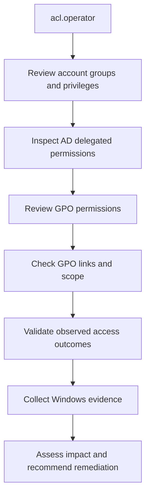

# Active Directory Privilege Escalation Assessment

## 1. Objective

The objective of this lab is to assess how misconfigured Active Directory permissions and delegated Group Policy rights can create privilege-escalation risks.

The exercise uses a controlled Windows domain environment to inspect account privileges, delegated permissions, Group Policy scope, and observable access-control outcomes.

The assessment documents both the security risk and the limits of the evidence collected.

## 2. Lab Environment

| Component | Details |
|---|---|
| Domain | `harish.local` |
| NetBIOS domain | `HARISH` |
| Domain Controller | `DC01` |
| DC01 IP | `192.168.182.10` |
| Client | `CLIENT01` |
| CLIENT01 IP | `192.168.182.20` |
| Test account | `HARISH\acl.operator` |
| Test GPO | `GPO-Abuse-Lab-Test` |
| GPO GUID | `413b79fd-b727-4092-a121-4f1bb6277f21` |
| Test OU | `OU=GPO-PE-Lab,DC=harish,DC=local` |

All testing was performed within the author's isolated lab environment.

## 3. What Is Privilege Escalation?

Privilege escalation occurs when a user or process obtains permissions beyond those intended for its current security context.

### Vertical privilege escalation

A low-privilege user obtains higher privileges, such as local administrator or a more privileged domain role.

### Horizontal privilege escalation

A user obtains access to another user's resources or security context at a similar privilege level.

In Active Directory, potential escalation paths can involve:

- Excessive group membership.
- Incorrectly delegated directory permissions.
- Misconfigured Group Policy permissions.
- Service accounts with excessive privileges.
- Weak permissions on scripts, services, or scheduled tasks.
- Credentials exposed on endpoints or in configuration files.

A suspicious permission is a potential attack path, not proof that escalation has occurred.

## 4. Lab Architecture



## 5. Assessment 1 — Account Security Context

The account context can be recorded on the client using:

```powershell
whoami
whoami /groups
whoami /priv
```

These commands display the current identity, security groups, and privileges available in the current logon session.

The output should be retained as baseline evidence. Group membership or privilege output should not be interpreted as proof of domain administrator access unless the relevant membership and effective permissions have been verified.

## 6. Assessment 2 — Active Directory ACLs

Active Directory access control lists (ACLs) determine which security principals can perform operations on directory objects.

Relevant permissions may include:

- Read or write properties.
- Create or delete child objects.
- Modify permissions.
- Change ownership.
- Reset a password.
- Modify sensitive attributes.
- Replication rights.

The potential impact depends on the object, the exact right, inheritance, deny entries, group membership, and the ability to reach a higher-privilege object.

Previous ACL inspection in this lab identified inherited property permissions related to `msDS-KeyCredentialLink` for Key Admins and Enterprise Key Admins. The direct membership count for those groups was zero in the recorded inspection. The reviewed Reset Password extended-right query did not return a matching ACE.

These observations did not establish an exploitable privilege-escalation path for `acl.operator`.

## 7. Assessment 3 — Delegated Group Policy Permissions

Group Policy Objects (GPOs) can configure user and computer settings. Users with rights to edit a GPO may be able to alter its settings, but the impact depends on where the GPO is linked and which users or computers process it.

### Recorded configuration

A dedicated test GPO named `GPO-Abuse-Lab-Test` was created. Its GUID was:

`413b79fd-b727-4092-a121-4f1bb6277f21`

The account `acl.operator` was delegated `GpoEdit` permission on this test GPO.

A test OU named `GPO-PE-Lab` was created, and `CLIENT01` was moved into the OU for controlled testing. The test GPO was linked to that OU.

The configured example setting was:

`User Configuration → Policies → Administrative Templates → Desktop → Hide and disable all items on the desktop`

This is a user-configuration setting, so computer-scope Group Policy results alone are insufficient to verify its application to a user session.

### Recorded validation results

- A `gpupdate /target:computer /force` attempt as `acl.operator` returned Access Denied.
- An administrative policy refresh succeeded.
- The recorded `gpresult /r /scope computer` output listed the Default Domain Policy, but did not verify the user-configuration setting.
- Successful privilege escalation was not demonstrated.

The Access Denied result does not, by itself, prove that the delegated GPO edit permission was ineffective. GPO editing, policy refresh, and policy application are distinct operations and must be evaluated separately.

## 8. Evidence Summary

| Test | Recorded result | Conclusion |
|---|---|---|
| Account context | Account and group inspection performed during the lab | Baseline information |
| AD ACL inspection | Sensitive permissions reviewed | No confirmed escalation path established |
| GPO delegation | `GpoEdit` permission delegated to `acl.operator` | Potentially security-relevant configuration |
| Client policy refresh | Access Denied for the computer-targeted refresh attempt | This operation was not authorized in the observed context |
| Administrative refresh | Succeeded | Administrative policy refresh worked |
| GPO application verification | Existing computer-scope results were inconclusive for the user setting | Additional correctly scoped evidence would be needed |
| Privilege escalation | Not demonstrated | No successful escalation claim is made |

## 9. Detection and Monitoring

Defenders can investigate privilege escalation using endpoint and domain-controller telemetry.

Useful Windows Security events may include:

- **4624:** Successful logon.
- **4672:** Special privileges assigned to a new logon.
- **4688:** Process creation, when auditing is enabled.
- **4728 / 4732:** A member added to a security-enabled global or local group.
- **4739:** Domain policy changed.
- **5136:** Directory service object modified, when appropriate auditing is enabled.

For Group Policy changes, review the available Group Policy operational logs and domain-controller security logs. Event availability depends on audit policy, operating-system version, and the operation performed.

An event should be correlated with the actor, target object, source host, timestamp, and expected administrative activity. No single event automatically proves malicious escalation.

## 10. Mitigation

1. Apply least privilege to users, service accounts, and delegated administrators.
2. Review GPO edit permissions and verify that only authorized principals can modify sensitive policies.
3. Limit the scope of GPO links to the required OUs.
4. Review inheritance and effective access rather than relying only on direct ACL entries.
5. Audit sensitive directory-object modifications and privileged group membership changes.
6. Protect administrative workstations and privileged credentials.
7. Remove unnecessary delegation through an approved change process.
8. Retest permissions and policy scope after remediation.

## 11. Interview Questions and Answers

### Q1. What is privilege escalation?

Privilege escalation is obtaining permissions beyond those intended for the current user or process.

### Q2. How can GPO permissions create a security risk?

If an account can edit a GPO that affects privileged users or sensitive computers, it may be able to change security-relevant settings. The actual impact depends on the policy contents and scope.

### Q3. Does `GpoEdit` automatically mean Domain Admin access?

No. It grants a form of GPO editing permission. The impact depends on the GPO's links, scope, settings, and effective permissions.

### Q4. What is the difference between GPO editing and GPO application?

Editing controls who can change a policy. Application depends on the GPO's links, scope, filtering, and the relevant user or computer processing policy.

### Q5. Does Access Denied prove that no escalation path exists?

No. It proves that the specific operation was denied in that context. Other permissions and paths require separate evaluation.

### Q6. Was privilege escalation successfully demonstrated in this lab?

No. The lab documented delegated GPO rights and reviewed ACLs, but the collected evidence did not establish a successful privilege escalation.

## 12. Conclusion

This assessment reviewed Active Directory ACLs and delegated Group Policy permissions in a controlled domain. It identified a delegated GPO editing permission that merits careful scope and impact analysis.

The results demonstrate practical experience with permission review, policy validation, and security evidence documentation. However, successful privilege escalation was not demonstrated, and the report does not claim otherwise.

