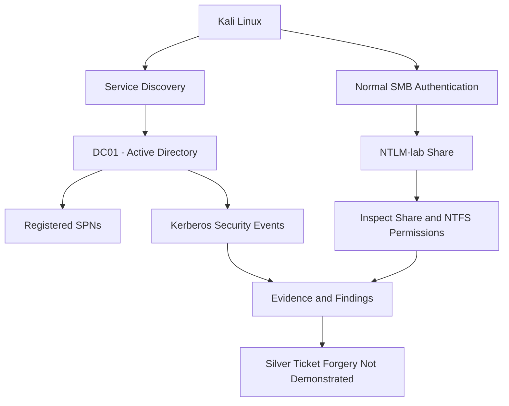

# Silver Ticket Attack — Active Directory Security Lab

## 1. Objective

The objective of this lab is to understand Kerberos Silver Ticket attacks, identify the target service and its Service Principal Name (SPN), inspect SMB access permissions, establish a normal-authentication baseline, and investigate relevant Kerberos security events.

The lab also documents the two attack objectives that remain incomplete:

1. Demonstrating a forged Silver Ticket.
2. Verifying service access using a forged ticket independently of normal password authentication.

**Lab status:** Service discovery, normal SMB authentication, share-permission inspection, and NTFS-permission inspection completed. Forged-ticket creation and independent ticket-based access were not demonstrated.

## 2. Lab Environment

| Component | Details |
|---|---|
| Domain | `harish.local` |
| NetBIOS domain | `HARISH` |
| Domain Controller | `DC01` |
| DC01 IP | `192.168.182.10` |
| Windows 11 client | `CLIENT01` |
| CLIENT01 IP | `192.168.182.20` |
| Kali Linux IP | `192.168.182.129` |
| Test account | `HARISH\acl.operator` |
| SMB share | `NTLM-lab` |
| Share path | `C:\NTLM-Lab` |
| Tools | Kali Linux, smbclient, Nmap, Windows PowerShell, Active Directory module |

All observations were collected from the author's isolated lab environment.

## 3. What Is a Silver Ticket?

A Silver Ticket is a forged Kerberos service ticket (TGS) created using the cryptographic key of the account associated with a target service.

Unlike a normal Kerberos authentication flow, a forged service ticket may be presented directly to the target service without a corresponding new service-ticket request to the domain controller.

A Silver Ticket generally targets a particular service and does not automatically provide unrestricted domain administrator privileges.

### Silver Ticket versus Golden Ticket

| Feature | Silver Ticket | Golden Ticket |
|---|---|---|
| Ticket type | Service ticket (TGS) | Ticket-Granting Ticket (TGT) |
| Relevant key | Target service account key | `krbtgt` account key |
| Target | A particular service | Can be used to request tickets for services, subject to ticket and domain conditions |
| Typical scope | Target service | Potentially broad domain impact |
| Detection considerations | Target-service and endpoint telemetry are important | Domain-controller Kerberos telemetry and endpoint evidence are important |

## 4. Lab Architecture



## 5. Practical Implementation

### Step 1: Verify network connectivity from Kali

Commands:

```bash
ip addr
ip route
ping -c 4 192.168.182.10
```

These commands identify the Kali network configuration, display routes, and test connectivity to DC01.

**Evidence:** Use the actual command output and a terminal screenshot in the project repository.

### Step 2: Identify exposed services

Command:

```bash
nmap -Pn -p 88,139,389,445 192.168.182.10
```

Relevant ports include:

- `88/TCP`: Kerberos.
- `139/TCP`: NetBIOS session service.
- `389/TCP`: LDAP.
- `445/TCP`: SMB.

The command checks the selected TCP ports. No specific port state is claimed here because the complete Nmap output was not recorded in the available evidence.

### Step 3: Inspect the registered SPNs

On DC01, PowerShell was used to inspect the computer account:

```powershell
setspn -L DC01
```

**Observed result:** The output showed multiple registered SPNs for DC01, including entries beginning with:

- `Dfsr-...`
- `ldap/DC01.harish.local/...`
- `DNS/DC01.harish.local`
- `GC/DC01.harish.local/harish.local`
- `RestrictedKrbHost/DC01.harish.local`
- `HOST/DC01.harish.local`

The full output also contained additional LDAP, HOST, and directory-service entries.

An explicit `cifs/DC01.harish.local` SPN was not found in the subsequent query:

```powershell
setspn -Q cifs/DC01.harish.local
```

**Interpretation:** The query did not find that exact SPN. This does not prove SMB is unavailable or that Kerberos cannot be used for SMB; service identity resolution can involve other registered SPNs and Windows behavior.

### Step 4: Inspect the SMB share

On DC01:

```powershell
Get-SmbShare -Name "NTLM-lab" |
    Select-Object Name, Path, Description
```

**Observed result:**

| Name | Path |
|---|---|
| `NTLM-lab` | `C:\NTLM-Lab` |

The share exists and points to the recorded local directory.

### Step 5: Inspect share-level permissions

Command:

```powershell
Get-SmbShareAccess -Name "NTLM-lab" |
    Format-Table AccountName, AccessControlType, AccessRight -AutoSize
```

**Observed result:**

| Account | Access type | Permission |
|---|---|---|
| `HARISH\Domain Users` | Allow | Read |

**Interpretation:** The share-level access-control list grants Read access to Domain Users. Effective access also depends on NTFS permissions and other applicable security controls.

### Step 6: Establish a normal SMB authentication baseline

From Kali, the available shares were enumerated using:

```bash
smbclient -L //192.168.182.10 -U 'HARISH/acl.operator'
```

The account password was entered interactively.

**Observed result:** The output listed the following shares:

```text
ADMIN$
C$
FINANCE
HR
IPC$
IT
NETLOGON
NTLM-lab
SYSVOL
Wallpapers
```

The command also printed an SMB1 workgroup-enumeration error after listing the shares:

```text
NT_STATUS_RESOURCE_NAME_NOT_FOUND
```

This later error did not invalidate the successful share enumeration.

The share was then opened:

```bash
smbclient //192.168.182.10/NTLM-lab -U 'HARISH/acl.operator'
```

At the SMB prompt:

```text
ls
```

**Observed result:**

```text
.
..
test.txt
```

The session was closed with:

```text
exit
```

**Interpretation:** The test account successfully authenticated through the normal SMB client workflow and listed the contents of `NTLM-lab`. This is the baseline against which a separate ticket-based authentication test would need to be compared.

This is not evidence of Silver Ticket creation or use.

### Step 7: Inspect NTFS permissions on the share directory

On DC01:

```powershell
Get-Acl C:\NTLM-Lab |
    Select-Object Owner, AccessToString |
    Format-List
```

**Observed owner:**

```text
BUILTIN\Administrators
```

**Observed access entries:**

```text
NT AUTHORITY\SYSTEM Allow FullControl
BUILTIN\Administrators Allow FullControl
BUILTIN\Users Allow ReadAndExecute, Synchronize
BUILTIN\Users Allow AppendData
BUILTIN\Users Allow CreateFiles
CREATOR OWNER Allow 268435456
```

The displayed directory ACL contains both read-related and additional write-related entries. The practical effect of these entries depends on the object type, inheritance, and Windows access checks.

### Step 8: Inspect NTFS permissions on the test file

Command:

```powershell
Get-Acl C:\NTLM-Lab\test.txt |
    Select-Object Owner, AccessToString |
    Format-List
```

**Observed owner:**

```text
BUILTIN\Administrators
```

**Observed access entries:**

```text
NT AUTHORITY\SYSTEM Allow FullControl
BUILTIN\Administrators Allow FullControl
BUILTIN\Users Allow ReadAndExecute, Synchronize
```

The recorded output establishes the displayed permissions for `test.txt`. It does not independently prove that a forged ticket was used.

### Step 9: Inspect Kerberos service-ticket events

The domain controller's Security log was queried for Event ID 4769.

**Observed event details:**

| Field | Observed value |
|---|---|
| Event ID | `4769` |
| Timestamp | `10/19/2026 10:13:25 AM` |
| Requesting account | `CLIENT01$@HARISH.LOCAL` |
| Service name | `DC01$` |
| Client address | `192.168.182.20` |
| Client port | `49698` |
| Ticket encryption type | `0x12` |
| Failure code | `0x0` |

**Interpretation:**

- `CLIENT01$` is the client computer account recorded in the event.
- `DC01$` is the service name recorded by the KDC.
- `192.168.182.20` matches the lab's recorded CLIENT01 IP address.
- Failure code `0x0` indicates that the KDC did not report a ticket-request failure.
- Encryption type `0x12` corresponds to AES-256 Kerberos encryption.

The event is consistent with a successful Kerberos service-ticket request. It does not prove that a Silver Ticket was forged or used.

A forged service ticket may be presented without a corresponding new KDC request. Therefore, Event 4769 absence alone cannot prove that a Silver Ticket attack occurred or did not occur.

## 6. Attack Objectives and Actual Status

| Objective | Status | Evidence |
|---|---|---|
| Identify the target domain controller | Completed | DC01 and its IP address recorded |
| Inspect registered SPNs | Completed | `setspn -L DC01` output |
| Query the explicit CIFS SPN | Completed | No matching exact SPN found |
| Enumerate SMB shares from Kali | Completed | Share listing output |
| Authenticate normally to `NTLM-lab` | Completed | Interactive SMB session opened |
| List the test file | Completed | `test.txt` listed |
| Inspect share-level permissions | Completed | Domain Users has Read access |
| Inspect directory and file ACLs | Completed | `Get-Acl` output |
| Inspect a Kerberos service-ticket event | Completed | Event 4769 output |
| Demonstrate a forged Silver Ticket | **Not demonstrated** | No forged-ticket evidence collected |
| Verify access using a forged ticket independently of a password | **Not demonstrated** | Only normal password-based SMB authentication was recorded |
| Demonstrate privilege escalation | **Not demonstrated** | No evidence of elevated access was collected |

## 7. Security Risks

If an attacker obtains a service account's key and successfully forges a ticket accepted by the target service, potential consequences include:

- Unauthorized access under the identity and privileges represented by the ticket.
- Access to sensitive data available to that service identity.
- Impersonation within the target service's authorization boundaries.
- Reduced visibility in telemetry that depends on normal KDC ticket issuance.
- Further compromise if the service account has excessive privileges or reuses credentials.

A Silver Ticket does not automatically grant domain administrator privileges. Its impact depends on the target service, the ticket contents, the service account's key, and the authorization checks performed by the service.

## 8. Detection and Monitoring

### Event 4769 — Kerberos service-ticket request

This event records service-ticket requests processed by a domain controller when appropriate auditing is enabled.

Investigators can review:

- Requesting account.
- Service name.
- Source IP address.
- Encryption type.
- Failure code.
- Timestamp and surrounding authentication events.

A successful 4769 event can be entirely normal. The event must be correlated with the account's expected behavior and other telemetry.

### Event 4624 — Successful logon

This event can help establish which account successfully logged on to a target system and which logon type was recorded.

### Event 4662 — Directory service object access

This event can provide evidence of audited Active Directory object operations when appropriate audit policy and SACLs are configured. It is not a universal Silver Ticket detection event.

### Service and endpoint telemetry

For possible forged-ticket activity, defenders should correlate service-side authentication records, endpoint logs, unusual service access, and KDC events. The absence of a KDC event alone is not sufficient to establish a forged-ticket attack.

## 9. Mitigation and Best Practices

1. Protect service account keys and credentials.
2. Use managed service accounts where appropriate.
3. Apply least privilege to service identities.
4. Avoid granting service accounts unnecessary administrative rights.
5. Review registered SPNs and investigate unexpected mappings.
6. Audit SMB share and NTFS permissions.
7. Enable suitable Kerberos and endpoint auditing.
8. Investigate unusual access patterns, especially from unexpected client systems.
9. Rotate compromised service credentials through a controlled process.
10. Validate changes after remediation and preserve relevant investigation evidence.

## 10. Interview Questions and Answers

### Q1. What is a Silver Ticket?

A Silver Ticket is a forged Kerberos service ticket created using the key of the account associated with a target service.

### Q2. How does it differ from a Golden Ticket?

A Silver Ticket targets a service ticket, whereas a Golden Ticket involves forging a TGT using the `krbtgt` account key.

### Q3. Does a Silver Ticket always provide administrator access?

No. Access depends on the target service, the ticket's contents, and the authorization permissions available to the represented identity.

### Q4. Does a Silver Ticket require a new Event 4769?

Not necessarily. A forged service ticket may be presented directly to the target service without a corresponding new KDC service-ticket request.

### Q5. What does the absence of an explicit CIFS SPN query result mean?

It means the exact queried SPN was not found. It does not establish that SMB is unavailable or that every possible Kerberos service mapping is absent.

### Q6. What did this lab prove?

It proved that normal SMB authentication from Kali to the `NTLM-lab` share succeeded, that the test file was listed, that the displayed share and NTFS permissions were inspected, and that a Kerberos service-ticket event was recorded for CLIENT01.

### Q7. Did this lab demonstrate a forged Silver Ticket?

No. Ticket forgery and independent ticket-based service access were not demonstrated.

## 11. Conclusion

This lab established the environment's service-discovery and SMB-access baseline. It documented the SPNs returned for DC01, the unsuccessful lookup for the exact CIFS SPN queried, normal SMB authentication from Kali, the share's permissions, the NTFS ACLs, and a Kerberos service-ticket event.

The evidence does **not** establish that a Silver Ticket was forged, that a forged ticket was accepted by SMB, or that privilege escalation occurred. These objectives remain incomplete and should not be marked as successful in the project portfolio.

The main defensive lessons are to protect service account keys, review service identities and permissions, and correlate service-side activity with Kerberos and endpoint telemetry.


