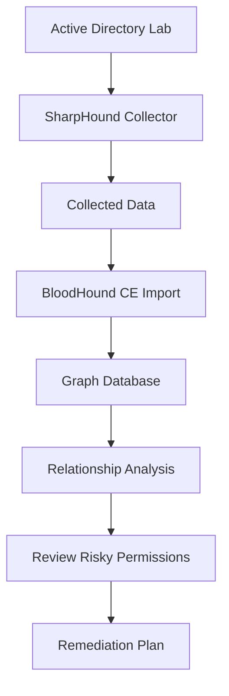

# BloodHound Community Edition — Active Directory Security Lab

## 1. Objective

Understand BloodHound Community Edition (CE), document its installation, and learn how graph-based analysis can help identify risky relationships and excessive privileges in Active Directory.

## 2. Overview

BloodHound is an identity and access relationship analysis platform maintained by SpecterOps. It uses graph theory to represent relationships between directory objects, computers, groups, and permissions.

Official resources:

- Repository: https://github.com/SpecterOps/BloodHound
- Documentation: https://bloodhound.specterops.io/
- Community Edition quickstart: https://bloodhound.specterops.io/get-started/quickstart/community-edition-quickstart

## 3. Lab Environment

| Component | Details |
|---|---|
| Domain | `harish.local` |
| Domain Controller | `DC01` |
| DC01 IP | `192.168.182.10` |
| Windows client | `CLIENT01` |
| Kali Linux IP | `192.168.182.129` |
| Environment | Isolated VMware lab |
| Planned edition | BloodHound Community Edition |

## 4. Architecture

BloodHound CE includes:

- **Web interface and API:** Used to interact with the application and its analysis features.
- **PostgreSQL:** Stores application state.
- **Neo4j:** Stores graph data and relationships.
- **SharpHound:** Collects Active Directory relationship data for import into BloodHound.

### Data flow

## 5. Installation Method

The planned installation method is the official BloodHound CE quickstart, using the supported installation workflow and its required dependencies.

Progress checklist:

- [ ] Docker or another supported container runtime verified.
- [ ] Docker Compose availability verified if required by the selected method.
- [ ] Official BloodHound CE installation instructions followed.
- [ ] Application starts successfully.
- [ ] Initial administrator password securely recorded and changed as instructed.
- [ ] Browser login verified.
- [ ] Screenshot of the running application added.

These items remain incomplete until verified in the lab.

## 6. Key Concepts

### Nodes

Nodes represent objects such as users, groups, computers, and domains.

### Relationships

Edges represent relationships such as group membership, delegated rights, or other access relationships.

### Potential attack paths

A graph may reveal a sequence of relationships that could lead to access to a more privileged account. A displayed path is a lead for investigation—not proof that exploitation occurred or that every step is currently usable.

## 7. Relationship with SharpHound

SharpHound gathers directory relationship information; BloodHound imports and analyzes the collected data.

The collector and server are separate components. Installing BloodHound does not automatically establish that SharpHound has collected data or that any findings exist.

## 8. Defensive Use Cases

BloodHound can help administrators investigate:

- Excessive group membership.
- Unnecessary delegated permissions.
- Risky relationships involving privileged accounts.
- Unintended access to computers or resources.
- Opportunities to simplify and reduce privilege assignments.

Any finding should be validated against the actual directory configuration and the organization's intended access policy.

## 9. Security and Scope

The lab is limited to the author's isolated Active Directory environment. Collection scope should be limited to the lab and the permissions required for the exercise.

BloodHound's database and interface may contain sensitive directory information. Restrict access, use strong credentials, avoid exposing service ports unnecessarily, and protect exported collection data.

## 10. Conclusion

BloodHound CE provides a visual way to analyze identity and permission relationships. Combined with SharpHound and careful validation, it can help identify and remediate excessive privileges in Active Directory.

Installation and analysis results will be documented only after the relevant steps have been completed and verified.
