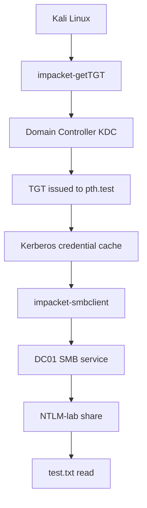

# Impacket — Active Directory Security Lab

## 1. Objective

The objective of this module is to understand Impacket, identify its relevant Kerberos and SMB utilities, and document how they were used in an isolated Active Directory lab.

The practical work focuses on requesting a Kerberos Ticket-Granting Ticket (TGT), inspecting the credential cache, and accessing an authorized SMB share.

## 2. Lab Environment

| Component | Details |
|---|---|
| Domain | `harish.local` |
| NetBIOS domain | `HARISH` |
| Domain Controller | `DC01` |
| Domain Controller IP | `192.168.182.10` |
| Kali Linux IP | `192.168.182.129` |
| Test account | `pth.test` |
| SMB share | `NTLM-lab` |
| Tool version | Impacket `0.14.0.dev0` |
| Environment | Isolated VMware lab |

## 3. What Is Impacket?

Impacket is a Python-based collection of classes and command-line tools for working with network protocols. Security professionals use it for protocol analysis, authentication testing, Active Directory assessments, and authorized security investigations.

Relevant protocols in this lab include:

- **Kerberos:** Network authentication protocol used by Active Directory.
- **SMB:** Protocol commonly used for Windows file sharing.
- **LDAP:** Protocol used to access directory information.
- **MSRPC:** Microsoft Remote Procedure Call, used by various Windows services.

Impacket provides individual utilities for different tasks rather than one single all-purpose application.

## 4. Tools Examined

### 4.1 `impacket-getTGT`

The `getTGT` utility requests a Kerberos Ticket-Granting Ticket and saves the resulting credentials in a Kerberos credential-cache file.

Help command:

```bash
impacket-getTGT -h
```

**Observed result:** The tool displayed its usage information and identified Impacket version `0.14.0.dev0`.

Important options shown in the output:

| Option | Purpose |
|---|---|
| `-dc-ip` | Specifies the domain controller's IP address. |
| `-hashes` | Supplies NTLM hash material in the documented format. |
| `-aesKey` | Supplies an AES key for Kerberos authentication. |
| `-k` | Attempts to use Kerberos credentials from the configured cache or command-line target parameters. |
| `-no-pass` | Suppresses the password prompt; commonly used with existing Kerberos credentials. |
| `-debug` | Enables detailed debugging output. |
| `-ts` | Adds timestamps to logging output. |

The help output describes the identity format as:

```text
[domain/]username[:password]
```

### 4.2 `impacket-smbclient`

The `smbclient` utility provides an interactive client for communicating with SMB services.

Help command:

```bash
impacket-smbclient -h
```

**Observed result:** The tool displayed its usage information and authentication and connection options.

Important options shown in the output:

| Option | Purpose |
|---|---|
| `-k` | Enables Kerberos authentication using available credentials. |
| `-no-pass` | Prevents a password prompt. |
| `-dc-ip` | Specifies the domain controller IP address. |
| `-target-ip` | Specifies the target system's IP address. |
| `-port` | Specifies the destination port. |
| `-inputfile` | Reads SMB-client commands from a file. |
| `-outputfile` | Writes SMB-client actions to a file. |
| `-debug` | Enables detailed debugging output. |

The help output identifies the target format as:

```text
[[domain/]username[:password]@]<targetName>
```

## 5. Practical Work Completed

### Step 1 — Verify Impacket utilities

The following commands were executed on Kali Linux:

```bash
impacket-getTGT -h
impacket-smbclient -h
```

**Result:** Both commands displayed their help output. This confirms that the two utilities are callable from the current Kali environment.

### Step 2 — Request a TGT

A TGT was requested for the dedicated lab account:

```bash
impacket-getTGT harish.local/pth.test -dc-ip 192.168.182.10
```

The account password was entered at the prompt rather than written in the command.

**Previously observed result:** A file named `pth.test.ccache` was created.

### Step 3 — Inspect the Kerberos cache

The cache location was configured using:

```bash
export KRB5CCNAME="$PWD/pth.test.ccache"
```

The cache was inspected using:

```bash
klist
```

The observed output identified the default principal as `pth.test@HARISH.LOCAL` and listed a ticket for `krbtgt/HARISH.LOCAL@HARISH.LOCAL`.

This confirmed that the cache contained a TGT for the lab account.

### Step 4 — Access the authorized SMB share

The SMB client was invoked using the cached Kerberos credentials:

```bash
KRB5CCNAME="$PWD/pth.test.ccache" impacket-smbclient -k -no-pass harish.local/pth.test@DC01.harish.local
```

Within the interactive client, the `NTLM-lab` share was selected and listed. The file `test.txt` was present, and reading it returned:

```text
NTLM Lab Test
```

**Result:** The test account's cached Kerberos credentials were used to access the tested SMB share and read its test file.

## 6. Understanding the Authentication Flow



The key distinction is that requesting a TGT with a known account password and subsequently using the cached ticket are separate operations.

- `getTGT` requests a TGT from the KDC.
- The credential cache stores Kerberos credentials for later use.
- `smbclient -k` attempts Kerberos authentication using available credentials.
- The SMB server evaluates the authenticated identity's permissions before allowing access.

Successful authentication does not automatically grant administrator privileges.

## 7. Security Significance

Impacket can support legitimate security testing, but the same protocol capabilities may be misused if an attacker has access to valid credentials or tickets.

Potential risks include:

- Unauthorized access to network shares.
- Authentication using compromised credentials.
- Abuse of accounts with excessive permissions.
- Lateral movement where the compromised identity has access to additional systems.

The practical lesson is that protecting credentials and tickets, enforcing least privilege, and monitoring authentication activity are essential parts of Active Directory security.

## 8. Detection and Defensive Investigation

During an authorized investigation, defenders can correlate Windows Security events with endpoint and network telemetry.

| Event ID | General significance |
|---|---|
| `4768` | A Kerberos TGT was requested. |
| `4769` | A Kerberos service ticket was requested. |
| `4624` | A logon succeeded. |
| `4625` | A logon failed. |
| `5140` | A network share was accessed. |
| `5145` | A network-share access check was performed. |

These events are useful investigation sources, not definitive indicators of malicious activity. Availability and details depend on audit configuration and the activity performed.

Investigators should correlate account, source IP, destination service, timestamp, and expected activity before drawing conclusions.

## 9. Limitations

This lab demonstrated TGT acquisition using the known password of a dedicated test account and subsequent SMB access using the resulting credential cache.

It did **not** demonstrate stealing another user's ticket, forging a Kerberos ticket, extracting account secrets, or obtaining administrator privileges.

Only the share and file actually tested are included in the results.

## 10. Conclusion

Impacket provides useful protocol-focused utilities for authorized Active Directory security testing. In this lab, both `getTGT` and `smbclient` were verified, a TGT was obtained for the test account, the Kerberos cache was inspected, and the cached credentials were used to read a file from the authorized SMB share.

This exercise establishes a practical foundation for understanding Kerberos authentication, credential caches, SMB access, and related defensive monitoring.

