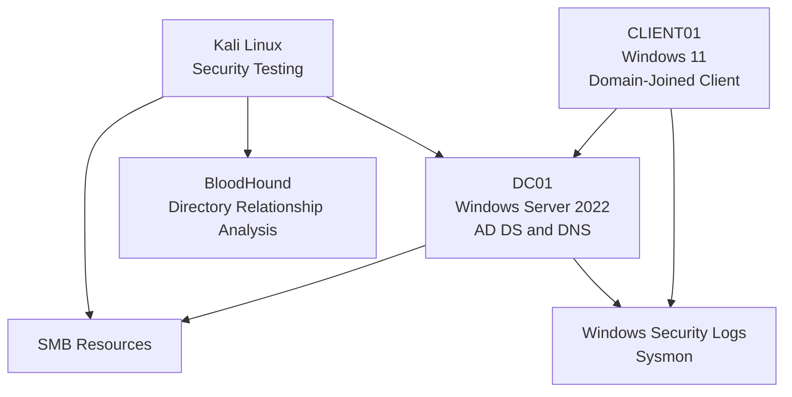

# Active Directory Security and Attacks

## Project Overview

This repository documents a hands-on Active Directory security lab built to study enterprise authentication, directory services, reconnaissance, credential attacks, privilege escalation, lateral movement, and defensive monitoring.

The lab uses Windows Server 2022, Windows 11, Kali Linux, and supporting security tools to explore how Active Directory works, how misconfigurations can introduce security risks, and how defenders can investigate suspicious activity.

The repository contains structured technical documentation, practical lab exercises, screenshots, tool references, commands, observed results, and defensive recommendations. Each assessment distinguishes between theoretical attack concepts, actions performed, and outcomes supported by collected evidence.

---
## Project Statistics

- **9 Project Modules**
- **150 Screenshots**
- **3 Lab Systems** — Windows Server 2022, Windows 11, and Kali Linux
- **1 Active Directory Domain**
- Multiple Active Directory Users, Groups, and OUs
- Reconnaissance and Security Assessments
- Detection and Defense Documentation
  
---
## Project Objectives

- Understand Active Directory security fundamentals.
- Learn Kerberos, LDAP, NTLM, authentication, authorization, and delegation.
- Configure a security testing environment using Kali Linux and BloodHound.
- Study DNS, SMB, and LDAP reconnaissance techniques.
- Understand common credential attacks and their security implications.
- Assess Active Directory permissions and potential privilege-escalation paths.
- Investigate Kerberos ticket attacks and domain replication risks.
- Analyze Windows Security logs and Sysmon telemetry.
- Document detection methods and defensive controls.
- Develop practical Active Directory security assessment skills.

---

## Lab Environment

| Component | Details |
|---|---|
| Hypervisor | VMware Workstation |
| Domain | `harish.local` |
| NetBIOS Domain | `HARISH` |
| Domain Controller | `DC01` |
| Server Operating System | Windows Server 2022 |
| Client Machine | `CLIENT01` |
| Client Operating System | Windows 11 |
| Attack Machine | Kali Linux |
| Domain Controller IP | `192.168.182.10` |
| Client IP | `192.168.182.20` |
| Kali Linux IP | `192.168.182.129` |
| Lab Network | `192.168.182.0/24` |
| Directory Services | Active Directory Domain Services |
| Name Resolution | Active Directory-integrated DNS |

*The network details describe the lab configuration used during testing. Verify the VMware network mode and connectivity restrictions before describing the environment as fully isolated.*

---

## Lab Architecture



*The diagram represents the main lab components and their relationships. BloodHound's database and collection workflow are documented separately in the setup modules.*

---

## Repository Structure

```text
Active-Directory-Security-and-Attacks/
│
├── README.md
│
├── 01-Project-Overview/
│   ├── Lab-Architecture.md
│   ├── Lab-Requirements.md
│   ├── Learning-Roadmap.md
│   └── Project-Goal.md
│
├── 02-Active-Directory-Fundamentals/
│   ├── Active-Directory-Security-Basics.md
│   ├── Authentication.md
│   ├── Authorization.md
│   ├── Delegation.md
│   ├── Kerberos.md
│   ├── LDAP.md
│   ├── NTLM.md
│   ├── Service-Principal-Names.md
│   └── Screenshots/
│
├── 03-Attack-Lab-Setup/
│   ├── Attack-Machine-Configuration.md
│   ├── Neo4j.md
│   ├── BloodHound-Setup.md
│   ├── Kali-Linux.md
│   ├── Lab-Prerequisites.md
│   └── Screenshots/
│
├── 04-Reconnaissance/
│   ├── DNS-Enumeration.md
│   ├── SMB-Enumeration.md
│   ├── LDAP-Enumeration.md
│   ├── BloodHound.md
│   ├── SharpHound.md
│   └── Screenshots/
│
├── 05-Credential-Attacks/
│   ├── Credential-Dumping.md
│   ├── Password-Spraying.md
│   ├── Brute-Force.md
│   ├── Pass-the-Ticket.md
│   ├── Pass-the-Hash.md
│   ├── Kerberoasting.md
│   ├── AS-REP-Roasting.md
│   └── Screenshots/
│
├── 06-Privilege-Escalation/
│   ├── ACL-Abuse.md
│   ├── GPO-Abuse.md
│   ├── DCSync.md
│   ├── Silver-Ticket.md
│   ├── Golden-Ticket.md
│   ├── Privilege-Escalation.md
│   ├── Lateral-Movement.md
│   └── Screenshots/
│
├── 07-Detection-and-Defense/
│   ├── Event-Logs.md
│   ├── Sysmon.md
│   ├── Detection.md
│   ├── Mitigation.md
│   └── Screenshots/
│
├── 08-Tools/
│   ├── BloodHound.md
│   ├── SharpHound.md
│   ├── Mimikatz.md
│   ├── Rubeus.md
│   ├── CrackMapExec.md
│   └── Impacket.md
│
└── 09-Commands/
    ├── Linux/
    ├── PowerShell/
    └── Windows/
```

---

## Modules at a Glance

### 01 — Project Overview

Defines the lab's goals, requirements, architecture, and learning roadmap.

### 02 — Active Directory Fundamentals

Covers the concepts required to understand Active Directory security, including authentication, authorization, delegation, Kerberos, LDAP, NTLM, and Service Principal Names (SPNs).

### 03 — Attack Lab Setup

Documents the attack-machine configuration, Kali Linux environment, Neo4j, BloodHound setup, and lab prerequisites.

### 04 — Reconnaissance

Explores DNS, SMB, and LDAP enumeration, along with BloodHound analysis and SharpHound data collection.

### 05 — Credential Attacks

Studies credential dumping, password spraying, brute-force attacks, Pass-the-Ticket, Pass-the-Hash, Kerberoasting, and AS-REP Roasting.

These topics are investigated only within authorized test environments. Documentation should distinguish conceptual explanations from attacks actually executed.

### 06 — Privilege Escalation

Examines ACL abuse, GPO abuse, DCSync prerequisites, Silver Ticket and Golden Ticket concepts, privilege-escalation paths, and lateral-movement risks.

### 07 — Detection and Defense

Documents Windows event logs, Sysmon telemetry, detection strategies, and mitigation techniques associated with Active Directory security.

### 08 — Tools

Provides individual references for BloodHound, SharpHound, Mimikatz, Rubeus, CrackMapExec, and Impacket, including their purpose, setup or availability checks, lab usage, and limitations.

### 09 — Commands

Organizes frequently used commands into three categories:

- **Linux:** system administration, networking, and security assessment utilities.
- **PowerShell:** Windows administration, Active Directory queries, and troubleshooting.
- **Windows:** command-line administration, networking, and diagnostic commands.

---

## Evidence and Documentation

Each practical assessment should document the following wherever applicable:

1. **Objective** — What the test is intended to investigate.
2. **Prerequisites** — Required permissions, configuration, and lab conditions.
3. **Methodology** — The steps performed in the lab.
4. **Commands and tools** — The commands actually used.
5. **Screenshots** — Evidence of configuration, execution, and results.
6. **Observed results** — What succeeded, failed, or remained inconclusive.
7. **Security implications** — Why the finding matters.
8. **Detection** — Relevant logs, telemetry, and investigation steps.
9. **Mitigation** — Recommended security controls.
10. **Limitations** — What the test did not demonstrate.

Screenshots should be stored in the corresponding module's `Screenshots/` folder and referenced from its Markdown documentation using relative paths.

---

## Detection and Defensive Focus

The project considers the following defensive areas:

- Active Directory ACL and delegation reviews.
- Privileged account and group-membership monitoring.
- Kerberos authentication and service-ticket analysis.
- Group Policy change monitoring.
- Directory replication permission reviews.
- SMB access auditing.
- Windows Security event analysis.
- Sysmon process and network telemetry.
- Least-privilege enforcement and attack-surface reduction.

Relevant event IDs include 4624, 4625, 4768, 4769, 4771, 4720, 4728, 4732, and 5136. Sysmon events such as 1, 3, 7, 11, and 22 may also be useful when the corresponding logging is enabled and configured.

These are relevant investigation references; their inclusion does not mean every event was generated or collected during every test.

---

## Skills Demonstrated

- Active Directory fundamentals and administration.
- Kerberos, LDAP, and NTLM concepts.
- DNS, SMB, and LDAP reconnaissance.
- Active Directory permission and delegation assessment.
- Group Policy security review.
- Credential-attack concepts and prerequisites.
- BloodHound relationship analysis.
- Windows Security event and Sysmon investigation.
- PowerShell and Linux command-line usage.
- Technical documentation and evidence-based reporting.

---

## Scope and Disclaimer

This project is intended for educational purposes and authorized security testing. All practical testing must remain within systems and accounts for which permission has been granted.

The repository documents both successful and unsuccessful assessments. A technique listed in the repository is not automatically a successfully executed attack. Claims of credential extraction, ticket forgery, privilege escalation, or unauthorized lateral movement must be supported by actual lab evidence.

---
## Tools & Software Installation Links

The following tools and software are relevant to building the lab, studying Active Directory, performing authorized security assessments, and investigating security events. Use official download pages and documentation whenever possible.

### 1. Lab Infrastructure

| Software | Purpose | Official link |
|---|---|---|
| VMware Workstation Pro | Run the lab virtual machines | [Download VMware Workstation](https://support.broadcom.com/) |
| Windows Server 2022 | Domain Controller and AD DS | [Microsoft Evaluation Center](https://www.microsoft.com/en-in/evalcenter/evaluate-windows-server-2022) |
| Windows 11 | Domain-joined client machine | [Download Windows 11](https://www.microsoft.com/software-download/windows11) |
| Kali Linux | Security testing environment | [Kali Linux Downloads](https://www.kali.org/get-kali/) |

### 2. Active Directory and Reconnaissance

| Tool | Purpose | Official link |
|---|---|---|
| BloodHound Community Edition | Visualize and analyze Active Directory relationships | [BloodHound GitHub](https://github.com/SpecterOps/BloodHound) |
| SharpHound | Collect Active Directory relationship data for BloodHound | [SharpHound GitHub](https://github.com/SpecterOps/SharpHound) |
| Neo4j | Graph database used by certain BloodHound workflows | [Neo4j Downloads](https://neo4j.com/download/) |
| Impacket | Network protocol tools, including Kerberos and SMB utilities | [Impacket GitHub](https://github.com/fortra/impacket) |
| CrackMapExec | Legacy network security assessment framework | [CrackMapExec GitHub](https://github.com/byt3bl33d3r/CrackMapExec) |
| NetExec | Maintained successor project in the same tool family | [NetExec GitHub](https://github.com/Pennyw0rth/NetExec) |

### 3. Kerberos and Windows Security Research

| Tool | Purpose | Official link |
|---|---|---|
| Rubeus | Kerberos security research and ticket analysis | [GhostPack/Rubeus](https://github.com/GhostPack/Rubeus) |
| Mimikatz | Windows authentication and credential-security research | [Mimikatz GitHub](https://github.com/gentilkiwi/mimikatz) |
| PowerShell | Windows administration and Active Directory investigation | [PowerShell Documentation](https://learn.microsoft.com/en-us/powershell/) |
| Sysmon | Record selected endpoint activity for security monitoring | [Sysmon Documentation](https://learn.microsoft.com/en-us/sysinternals/downloads/sysmon) |
| Windows Event Viewer | Review Windows Security and system events | [Event Viewer Documentation](https://learn.microsoft.com/en-us/shows/inside/event-viewer) |

### 4. Documentation and References

| Resource | Purpose | Official link |
|---|---|---|
| Microsoft Active Directory Domain Services | AD DS concepts and administration | [Microsoft Learn](https://learn.microsoft.com/en-us/windows-server/identity/ad-ds/) |
| Kerberos authentication | Understand Kerberos authentication in Windows | [Microsoft Learn](https://learn.microsoft.com/en-us/windows-server/security/kerberos/kerberos-authentication-overview) |
| LDAP | Understand directory access protocols | [RFC 4511](https://www.rfc-editor.org/rfc/rfc4511) |
| Windows Security Auditing | Understand Windows audit events | [Microsoft Learn](https://learn.microsoft.com/en-us/windows/security/threat-protection/auditing/basic-audit-logon-events) |
| Sysinternals Suite | Additional Windows troubleshooting and investigation tools | [Microsoft Sysinternals](https://learn.microsoft.com/en-us/sysinternals/) |

### Installation Notes

- Download operating systems and software from official sources. Verify checksums or signatures when the publisher provides them.
- Windows Server evaluation editions have licensing and expiration conditions. Review Microsoft's current terms before use.
- VMware Workstation availability and download access may require a Broadcom account. Check the publisher's current licensing terms.
- BloodHound deployment requirements vary by edition and version. Follow the official installation instructions for the edition used in the lab.
- Neo4j is included because some BloodHound workflows use it; verify the database requirements for your chosen BloodHound edition.
- CrackMapExec is a legacy project. For new work, review NetExec as its successor.
- Some security tools may trigger antivirus detections or require compilation. Use them only in an authorized lab and obtain source code from the official repositories.
- This list provides installation and reference links; it does not imply that every tool was used in every assessment.


## Author

**G Harish**

Focused on Active Directory security, Windows infrastructure, networking, security assessment, and defensive monitoring.

---

## Project Status

This repository is organized into nine modules covering project planning, Active Directory fundamentals, lab setup, reconnaissance, credential attacks, privilege escalation, detection and defense, tools, and command references.

Documentation and evidence should be updated as each assessment is completed and validated. The repository serves as a practical learning record of the lab configuration, security concepts investigated, and results observed.
